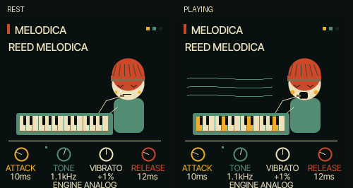

# UI 0.3.3 — expressive reed player

The melodica character now opens its mouth in response to audio level, puffs its
cheeks slightly and displays breath waves. A clear mouthpiece connects face and
keyboard. Closed eyes, a ribbed cap and a rounded body improve recognition at
240 × 240. Reduced-animation mode leaves a calm resting face.

Changed: firmware/src/reggae_ui.c, tests/reggae_graphics.c, web/emu/index.html,
UI_DESIGN.md and testing documentation. No sound-bank or synthesis changes.

Native graphics checks under AddressSanitizer pass, including mouth opening,
rest state, animation disable, existing rotary/focus behaviour and clipped edges.

Hardware and actual iPhone testing remain unverified. Next character work should
use meaningful performance gestures while keeping native-screen legibility.
