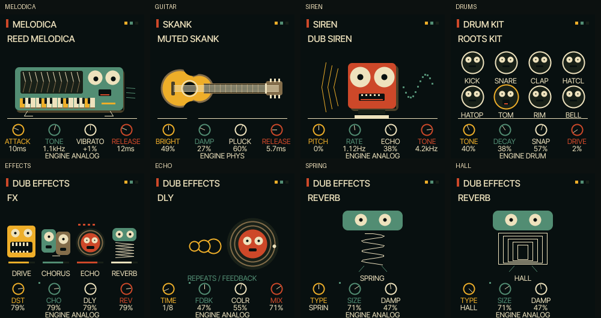

# UI 0.3.4 — a family of instrument creatures

Implemented a bellows-bodied melodica creature, wide-eyed siren, individual drum
faces, and a recognisable guitar silhouette. Replaced the FX overview bars with
four effect characters and redesigned the echo and reverb detail pages.

Changed: firmware/src/reggae_ui.c, tests/reggae_graphics.c, web/emu/index.html,
UI_DESIGN.md, README.md, TESTING.md, HARDWARE.md and this visual evidence.

Native graphics tests cover mouth response, animation disable, all four FX amount
responses, real FX pages, clipped primitives and existing rotary/focus behaviour.
Build and audio comparison results are in TESTING.md. Physical FM-1 operation and
actual iPhone Safari remain untested. No sound changes in this release.

Access the existing emulator with ?ui=0.3.4, select Reed Melodica, Muted Skank,
Dub Siren or Roots Kit, or open FX. Existing page navigation and knobs are retained.
Next priority: musician feedback on this character family and physical rendering
headroom once an FM-1 is available.
