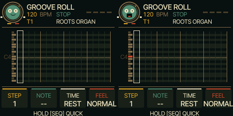

# UI 0.5.2 — the record character

SEQ's 45 label now has eyes, a smiling/open mouth, tiny hands and feet. Its mouth
responds to the selected track's actual active synth/drum voices, including release
tails, and closes when they finish. The compact arranger character responds to
voices across all four tracks. This is a voice-activity illustration, not a peak
meter; it does not measure the post-mixer signal.

The groove marker follows sequencer position while the face stays upright. The
character looks across beats, blinks when resting and lifts its hands/bobs when
voices sound. Reduced animation disables those motions but keeps mouth feedback.
All rendering remains native C at up to 10 Hz within the existing 240×240 layout
and strip buffer. No audio callback, DSP, preset or control changes.

The EDIT+SEQ whole-roll clear and SAVE undo from UI 0.5.1 remain. No additional
SLOOP functionality was introduced. Tests and target sizes are in TESTING.md.
Public emulator: https://kemsthesage.github.io/reggae-os/?ui=0.5.2

