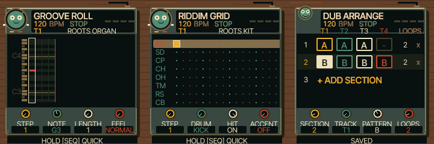

# UI 0.5.3 — sequencer on the desk

The sequencer is drawn as a small metal machine on a wooden tabletop, with an
inset editing screen, rotary indicators, cable, feet and an animated record
companion. The piano roll, drum grid and arranger share this treatment. Knob
indicators follow real editing values. Existing note-driven mouth and beat motion
remain, including reduced-animation support.

Changed: `firmware/src/reggae_seq_ui.c`, emulator version/cache identifiers and
project documentation. All visuals run in the shared native 240×240 renderer.
Existing sounds, recording, editing shortcuts and project storage are unchanged.

Native AddressSanitizer and WASM sequencer regressions pass, as do all 75 audio
parity checks and the upstream emulator tests. The FM-1 firmware builds within
its memory/flash guards. See [TESTING.md](../../TESTING.md) for measurements.
Physical hardware and mobile Safari remain untested. Further SLOOP integration
is deferred; the next priority is musician feedback on readability and use.

Open https://kemsthesage.github.io/reggae-os/?ui=0.5.3 and press SEQ; GLO opens
the arranger from the sequencer. Refresh if an older version is cached.

