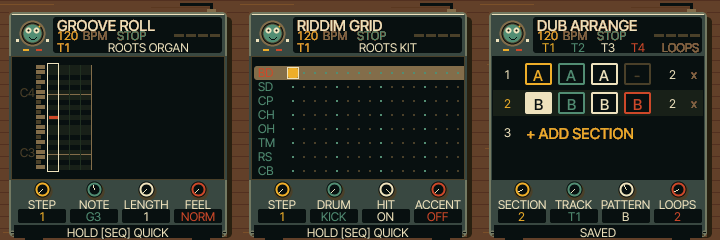

# UI 0.5.4 — sequencer layout correction

The animated character now fits entirely within a dedicated header bay, including
its hands and feet. Title, transport and preset text have separate vertical bands.
The case extends around the bottom help strip, value wells have more padding,
and long names/messages are ellipsised at the existing font size.

Changed: shared firmware renderer, character bounds regression, emulator version
and documentation. Sounds, controls and recording behaviour are unchanged.
Physical hardware and iPhone Safari remain untested. See TESTING.md for build
and regression results. Next priority: musician feedback on the corrected layout.

Open https://kemsthesage.github.io/reggae-os/?ui=0.5.4 and press SEQ.

