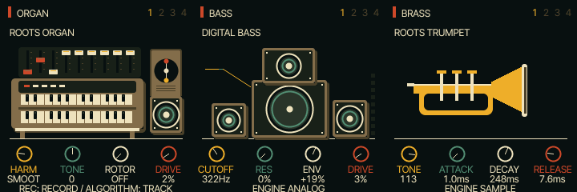

# UI 0.5.5 — smaller instrument names

Instrument category and preset names now use the existing 9-pixel-capital font,
down from 11 pixels, with more breathing room in the performance header. Longer
names are fitted within the screen margins. Effects titles and sequencer labels
retain their existing sizes. Sounds and controls are unchanged.

Files: shared firmware performance renderer, emulator version and documentation.
Native renders cover all 15 presets. See TESTING.md for release checks.
Physical FM-1 and iPhone Safari remain untested.

Open https://kemsthesage.github.io/reggae-os/?ui=0.5.5.

