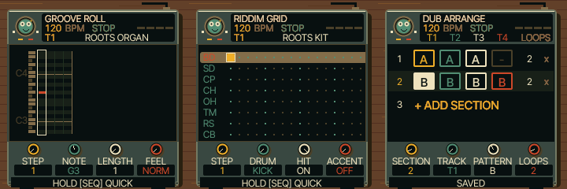

# UI 0.5.6 — smaller sequencer headings

GROOVE ROLL, RIDDIM GRID and DUB ARRANGE now use the existing small native font.
This reduces their capital height from 11 to 9 pixels and adds space above the
tempo/status row. The previous change affected instrument performance screens;
this change addresses the sequencer heading shown in the musician's screenshot.

Changed: shared sequencer renderer, emulator version and documentation. No sound,
control, character or sequencing behaviour changes. See TESTING.md for checks.
Physical FM-1 and iPhone Safari remain untested.

Open https://kemsthesage.github.io/reggae-os/?ui=0.5.6 and press SEQ.

