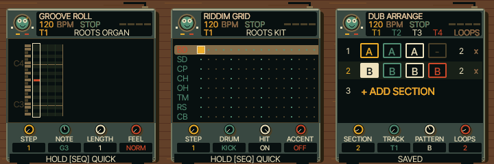

# UI 0.5.7 — compact sequencer parameters

The four parameter labels and values now use a smaller native font on the piano
roll, drum grid and arranger. Typography is generated from the existing licensed
Inter Tight font, with no browser scaling. Knob illustrations, values, controls
and sound are unchanged.

Changed: shared sequencer renderer, font generator, emulator version and docs.
See TESTING.md for build results. Physical FM-1 and iPhone Safari are untested.

Open https://kemsthesage.github.io/reggae-os/?ui=0.5.7 and press SEQ.

