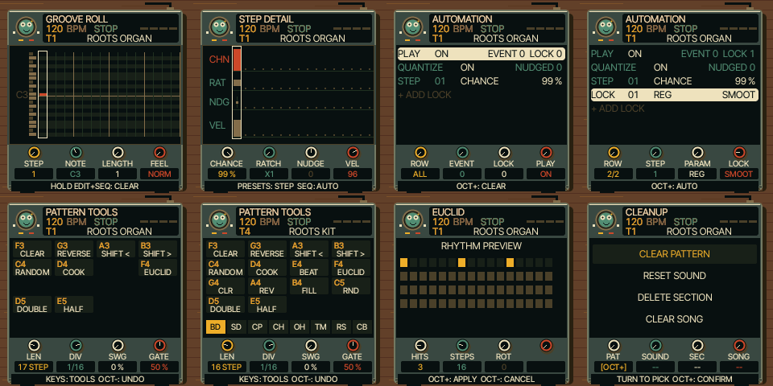

# UI 0.5.8 — consistent sequencer menus

The clear shortcut is now a small HOLD EDIT+SEQ: CLEAR hint. All sequencer footer
messages use the compact font and fit inside the case.

STEP DETAIL, AUTOMATION, held-SEQ pattern tools, Euclid preview and SAVE > TOOLS
now share the tabletop case, animated record character and compact parameter
cards. The existing formatting/editing/action code is reused. The detail graph
retains its four lanes; automation retains its records, units and selection.
Tool cells show the physical keyboard note and action; drum lane selection is
shown below. Euclid shows its current hit pattern.

Changed: shared sequencer, graph, card and layer renderers; native regression
and test runner; emulator version and documentation. No DSP or control mapping
changes. See TESTING.md for verification and hardware size measurements.

Project browser, mixer, recording settings and confirmation dialogs retain their
existing layouts. Those are separate follow-up work. Physical FM-1 and iPhone
Safari remain untested.

Open https://kemsthesage.github.io/reggae-os/?ui=0.5.8. Tap SEQ to cycle through
STEP, DETAIL and AUTOMATION. Hold SEQ for pattern tools; GLO opens ARRANGE.

