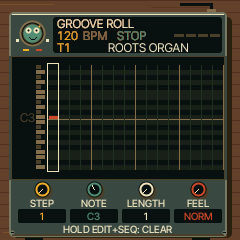

# UI 0.5.9 — hint without a bar

Removed the black strip behind sequencer hints. Small text now sits directly
on the case, slightly higher to clear the lower bevel. This applies to all pages
using the sequencer machine layout. Sounds and controls are unchanged.

Files: shared sequencer renderer, emulator version and documentation.
See TESTING.md for verification. Physical FM-1 and iPhone Safari are untested.

Open https://kemsthesage.github.io/reggae-os/?ui=0.5.9.

