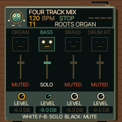
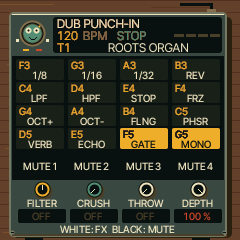
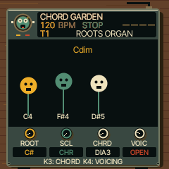

# UI 0.6.0 — live performance

[Open the emulator](https://kemsthesage.github.io/reggae-os/?ui=0.6.0).
Switch on, then use the printed hardware controls. No separate browser DSP.

- Hold **GLO**: four level knobs, first four black keys mute, F3/G3/A3/B3 solo
  while held. Double-tap GLO locks this screen; tap to leave. Speaker faces
  respond to voice activity and mute/solo state.
- Hold **FX**: sixteen white-key effects, including new F5 gate and G5 mono.
  Existing repeat/reverse/filter/throw effects are retained. Black keys mute.
- Tap **SCL twice** (separate taps): root, scale, chord type and voicing. Choose
  MAJ/MIN and DIA3/DIA7. Singing note characters show the last chord played.
- Optional **Load CC0 percussion on selected track** below the emulator:
  side-stick, conga, claves, shaker and tambourine from separately credited CC0
  sources. Uses an empty user slot; existing samples are preserved. Exact-key
  map and upload instructions are in the pack's attribution file.

| Mixer | Punch-ins | Chords |
|---|---|---|
|  |  |  |

All captures are the native 240×240 firmware framebuffer. The mixer capture
shows T2 soloed, demonstrating the sleeping faces on the other tracks.

Changed shared firmware: perform.c, params.c, ui_draw.c, ui_layer.c,
reggae_seq_ui.c and reggae_seq_tools.c. Emulator changes provide a sample-upload
shortcut to the same flash/decoder architecture; source WAVs, build script,
licensing and regression tests accompany it. No existing curated preset changed.

## Evidence

- Native AddressSanitizer panel regression: four levels, mute/solo, effect keys,
  chord root/voicing, audible chord and clean release passed.
- Existing chord suite passed (keyboard, MIDI, arpeggiator, recording, release).
- Existing performance functional checks plus gate/mono stereo, silence and
  release checks passed. Two Mac instruction-cost thresholds fail on both
  UI 0.5.9 and this build; they are not waived or reported as passes.
- All 75 native/WASM preset-and-knob PCM comparisons passed; 40 protected
  organ/piano/bass renders unchanged. Existing emulator regression passed.
- Five percussion zones passed actual WASM decoding: peaks 0.064–0.075,
  nonzero energy, silent tails; unmapped note silent. Pack reuse, occupied-slot
  protection, CRC-corruption rejection and flash reload passed.
- Local browser switched on, loaded USR1 and displayed the new GLO mixer.
- Hardware image 568,100 / 581,564 bytes; static RAM 61,064 / 73,728;
  pool 328,896 / 368,640. All packaging/memory guards passed.

**COMPILES:** FM-1 package. **EMULATOR TESTED:** shared rendering, sample playback,
controls and storage paths above. **HARDWARE UNTESTED:** physical FM-1 audio,
CPU headroom, USB sample upload and controls. iPhone Safari is also untested.

Scope: sixteen punch-ins, not all 27 SLOOP effects; existing chord synthesis
with a new playable layout, not Orchid's proprietary voicing engine; optional
SAMPLE percussion, not a sampled eight-lane DRUM kit. Jiant's parameter-linked
character approach informed original drawings, without copied artwork.
See [the research](../research/performance-0.6.md) for source links and tradeoffs.
