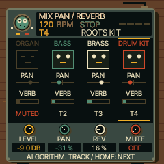

# UI 0.6.2 — themed pan and reverb mixer

From the instrument screen, tap HOME for the four-track level mixer, then
HOME again for **MIX PAN / REVERB**. Both pages stay open without holding a button.
Turn ALGORITHM to select a track; the gold outline identifies it.

| Knob | Selected-track control |
|---|---|
| 1 | Level |
| 2 | Pan (left/right) |
| 3 | Reverb send |
| 4 | Mute |

All four tracks remain visible with responsive speaker faces, horizontal pan
markers and reverb-send bars. These show parameter settings, not audio meters.
HOME continues to CLOCK, then the instrument. The original grey TRACK MIX
appearance has been replaced; its working parameter editing and storage paths
are reused. Presets and DSP are unchanged.

Changed firmware: params.c renames the second page; reggae_seq_ui.c routes it
through the shared tabletop renderer and existing formatted control cards;
reggae_seq_tools.c draws the track highlight and pan/reverb indicators.

Validation:
- Native AddressSanitizer panel test adjusts pan/reverb independently on all
  four tracks through physical knob and ALGORITHM input paths, captures the
  native framebuffer, and retains the previous mixer/chord/punch-in checks.
- New native ASAN mixer audio test verifies full-left/full-right pan energy
  exceeds the opposite channel by more than 10×. After note release the measured
  dry-window energy is 0, versus 1.67766509 with reverb send at 127.
- WASM sequencer-menu and complete emulator regression pass.
- FM-1 image 568,720 / 581,564 bytes; static RAM 61,064 / 73,728;
  pool 328,896 / 368,640. Hardware build and memory guards pass.
- WASM 869,127 bytes. Physical FM-1 and iPhone Safari remain untested.
