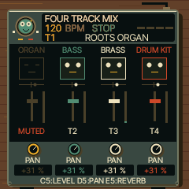
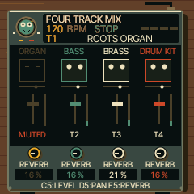

# UI 0.6.3 — one mixer, permanent vertical faders

Tap HOME from the instrument to open the single MIXER page. Knobs 1–4 address
tracks 1–4. Tap a virtual/physical key to choose their function:

| Key | Four-knob assignment |
|---|---|
| C5 | Volume (default on entry from the instrument) |
| D5 | Pan |
| E5 | Reverb send |

This changes the bottom labels and values in place. The vertical volume faders
remain visible and retain their actual volume positions in all three modes.
Pan markers sit above them; slim reverb-send bars sit beside them. These are
parameter indicators, not audio meters. Mute/solo keyboard actions are retained.
No page button needs to be held. HOME now cycles MIXER → CLOCK → instrument.

The separate PAN / REVERB page is removed. Shared changes are in params.c,
ui.c/ui_input.c/ui_layer.c and reggae_seq_ui.c/reggae_seq_tools.c. The assignment
is UI-only state; existing parameter editing, motion recording, MIDI learn and
sound/project storage paths are reused. No DSP or curated preset changes.
Hold-GLO remains an optional volume-only shortcut.

Verification: native ASAN panel regression switches C5/D5/E5 without a page
change or held button, checks all four track assignments and unchanged volume
values while editing pan/reverb, then checks direct mixer-to-clock navigation,
solo release and normal note keys. Native audio regression confirms pan steers
stereo output and reverb produces a tail: dry energy 0, wet energy 2.66167600.
WASM sequencer-menu and emulator regression pass. Screenshots are actual
240×240 firmware output.

FM-1 image 568,656 / 581,564 bytes; static RAM 61,064 / 73,728;
pool 328,896 / 368,640. Hardware build/memory guards pass. WASM 869,651 bytes.
Physical FM-1 and iPhone Safari remain untested.
