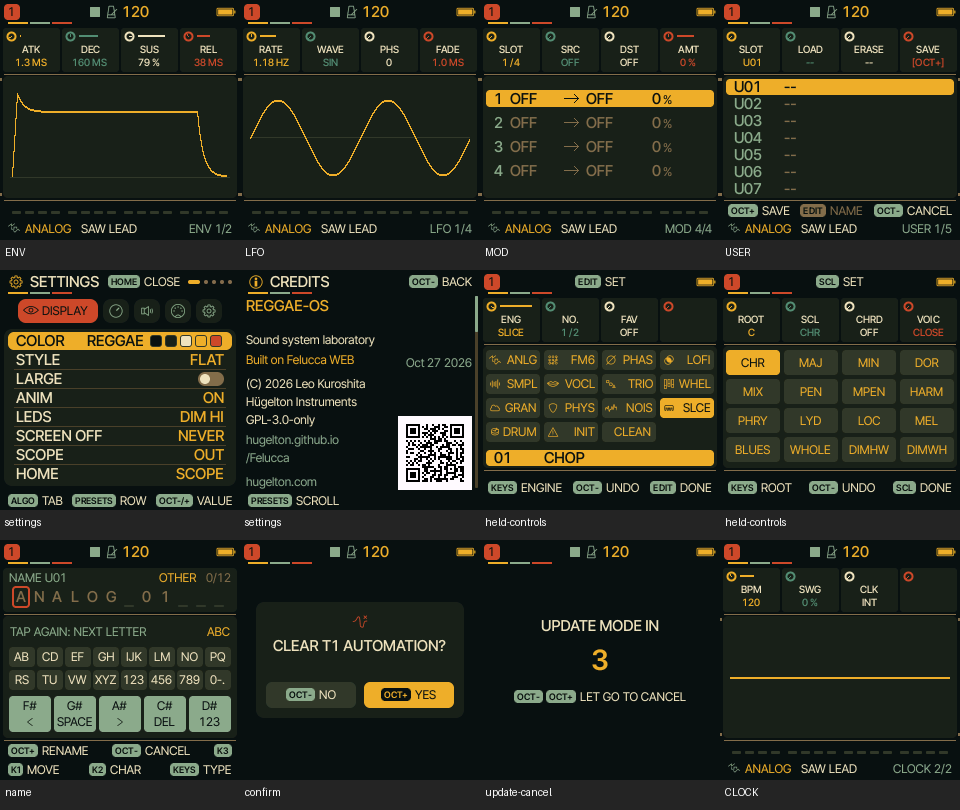

# UI 0.6.4 — shared REGGAE rack skin

This pass covers the fallback screens that previously retained the stock visual
style: envelope/LFO/modulation and engine editing, voice and routing controls,
preset/project storage, held EDIT/SCL/REC maps, settings, naming, confirmations
and the update-mode countdown. It reuses their working layouts and graphs.
It is a shared skin, not a new interaction model or a new character per page.

The REGGAE palette now has brass values, cream text, sage secondary labels and
vermilion alerts. Standard four-parameter cards use small rotary pointers and
native XS labels/values, matching the instrument controls. Rack seams, fasteners
and three enamel header tabs connect the technical editors visually. Settings
and credits identify REGGAE-OS, retaining Felucca attribution and licence notices.
Existing instrument/effects characters and sequencer/mixer artwork remain intact;
existing graphs still react to parameters. No DSP, presets or storage formats changed.

Coverage deliberately preserves accessible alternatives: other colour palettes
and the LARGE parameter layout remain available. A previously saved non-REGGAE
palette is not overwritten; choose SETTINGS → COLOR → REGGAE to use this skin.
Crash diagnostics and the separate low-level bootloader are unchanged. Technical
pages retain informative graphs rather than adding decorative character animations.

Changed implementation: gfx.c, reggae_ui.c, ui_draw.c, ui_graph.c, ui_menu.c;
web/emu/index.html updates the version/cache key. tests/reggae_skin.c is included
in tools/reggae/test.sh (also run by existing CI). It renders every visible page
for each engine, three system-menu views, physical held-button maps, naming,
confirmation and update countdown: 481 native screen states under AddressSanitizer.
This is rendering coverage, not a claim that every possible setting combination
or storage operation was manually tested. The atlas above was visually inspected.

Verification completed locally:
- Native ASAN screen sweep, sequencer-menu and live-performance regressions pass.
- Actual WASM audio equals existing native PCM for all 75 preset/knob cases,
  including protected organ/piano/bass sounds.
- WASM sequencer-menu and full emulator regression pass (including heavy-song audio).
- Hardware build and memory guards pass: application 569,564 / 581,564 bytes;
  static RAM 61,064 / 73,728; pool 328,896 / 368,640. No added framebuffer.

Status: COMPILES for FM-1; WASM tests pass; physical FM-1 and iPhone Safari
remain HARDWARE/DEVICE UNTESTED. Emulator: https://kemsthesage.github.io/reggae-os/ .
Next priority: musician feedback on navigation and readability, plus physical
hardware timing/audio verification before adding more feature scope.
