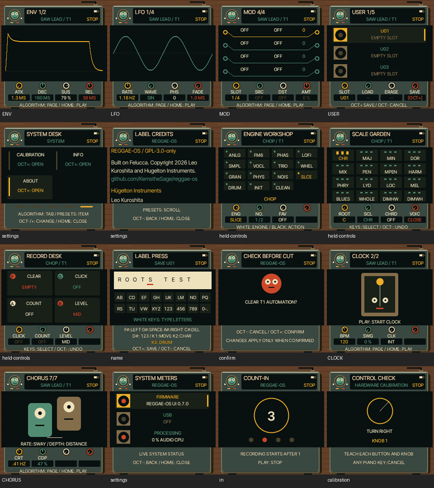

# UI 0.7.0 — replacement firmware workspaces

The previous release mainly recoloured the stock UI. This release replaces the
remaining normal page layouts with REGGAE-OS workspaces in the actual firmware.
It is not a browser skin. All pages use native 240×240 drawing and the same input,
synthesis, storage and MIDI paths as before.

## Coverage

| Surface | New presentation |
|---|---|
| Envelope, LFO, engine, filter, voice, arp, sample and FM editors | Workbench: identity/character above the working graph, four rotary controls below |
| Modulation routing | Four patch cables with source, destination and amount |
| User sounds, presets, phrases, projects | Three record sleeves with selection marker, names and slot status |
| Settings | SYSTEM DESK: four setting cards at a time, five category tabs |
| Held EDIT/SCL/REC | ENGINE WORKSHOP, SCALE GARDEN and RECORD DESK |
| Naming | LABEL PRESS: paper label, cursor, physical white-key alphabet and black-key shortcuts |
| Clock | Metronome character following sequencer position while playing |
| Chorus | Two companions; rate/depth control movement, voice activity opens mouths |
| Confirmation / count-in / update countdown | Matching full workspaces with explicit hardware actions |
| Credits / system information / calibration | LABEL CREDITS, SYSTEM METERS and CONTROL CHECK |

The previously approved instrument, effects, sequencer, arrangement and single
vertical-fader mixer screens remain. Technical graphs retain useful mathematical
content; they no longer sit inside stock page framing and top parameter cards.
The separate bootloader and crash diagnostics are not redesigned.

Settings: hold HOME, release when SYSTEM DESK appears. ALGORITHM switches category,
PRESETS moves through items (the next four cards appear as necessary), OCT−/+ or
any main knob changes a value. HOME closes. All original setting rows remain.
ANIM OFF freezes decorative movement. LARGE now provides an expanded live value
when adjusting a parameter; STYLE LINE adds frame rules. Workspaces use REGGAE's
fixed palette, like the existing instrument artwork, independent of legacy COLOR
settings. Legacy palette storage remains compatible.

## Implementation and verification

`firmware/src/reggae_workspace.c` implements the workspaces using existing
56/124/60-row strips. No new framebuffer or DSP processing. UI routing in
`ui_draw.c` now selects the existing REGGAE instrument/sequencer renderer or the
new workspace. `ui_input.c` redirects calibration drawing; `ui_menu.c` uses the
new credits scroll extent; `ui_layer.c` includes the shared implementation.
The browser cache key/version is UI 0.7.0.

- 518 page/menu states plus count-in and calibration render under AddressSanitizer.
  This includes every visible page across engines and every settings row.
- Native screenshots above inspected for title, label and control fit.
- Physical-input tests: Settings hold/open/tab/item/change/close; held SCL over
  sequencer; envelope edits; typing and saving a named user preset; confirmation
  cancellation; chorus redraw. Existing mixer/punch/chord and sequencer-menu tests pass.
- Step-gesture regression passes: EDIT adds/deduplicates, REC replaces, combined
  clear, whole-roll clear/cancel/undo and no stuck notes. These gestures are unchanged.
- Release WASM: audio parity, sequencer-menu and full emulator regression checked
  before deployment. No sound-bank/DSP edits; all 75 preset/knob PCM comparisons
  match the existing native audio fixtures.
- Final FM-1 image **542,288 / 581,564 bytes**; static RAM **61,000 / 73,728**;
  pool **328,896 / 368,640**. Hardware build and guards pass. WASM **800,399 bytes**.
  Unused stock drawing functions are omitted by the compiler/linker.

COMPILES for physical FM-1; shared firmware/WASM exercised. Physical FM-1 and
actual iPhone Safari remain untested. Rendering coverage is not exhaustive
verification of every setting combination or physical display/audio timing.

Emulator: https://kemsthesage.github.io/reggae-os/?v=0.7.0 .
Next priority is musician feedback on these layouts and physical-device testing,
not adding more unrelated features.
